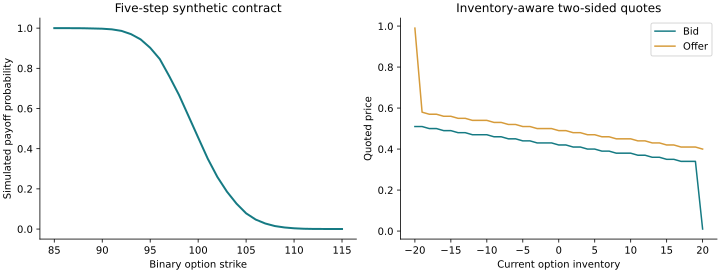

# Akuna Market Making Lab

**A competition-derived binary-options strategy: estimate, price, quote, manage exposure.**

A Python market maker for synthetic rate and equity underlyings. The implementation
connects historical parameter estimation, vectorized Monte Carlo probabilities,
inventory-aware quotes and fill-or-kill decision gates.



## Strategy pipeline


- Estimate a discrete mean-reverting rate process with bounded optimization.
- Regress equity log returns on rate changes and extract a shared residual factor.
- Price single- and multi-leg binary contracts with seeded, vectorized paths.
- Adjust quote centers with inventory; round quotes to whole pennies.
- Screen FOK requests with inventory limits, a cash buffer and minimum price edge.

## Reproduce

Python **3.11+** is required (`enum.StrEnum`). No credentials or network are needed.

```bash
python -m venv .venv
source .venv/bin/activate
pip install -r requirements.txt
python examples/synthetic_market.py
python -m unittest discover -s tests
```

The example creates synthetic market history, runs calibration, and regenerates
the figure plus `figures/results.json`. The strategy module exposes competition-
style callbacks; it is not a standalone exchange or a bundled competition harness.

## Model and risk scope

Prices are undiscounted simulated payoff probabilities under estimated dynamics.
They are not asserted to be arbitrage-free risk-neutral valuations. Inventory
skew in two-sided quotes is a soft control; hard quantity/cash gates are applied
in `respond_to_fok`. The cash callback follows the source's margin-reservation
convention and does not implement a complete settlement ledger. Fallback estimates
and broad exception handlers remain part of the original strategy design.

The demo reports **no competition rank, P&L or live-trading performance**.
See [VALIDATION.md](VALIDATION.md), [CHANGES.md](CHANGES.md) and
[PROVENANCE.md](PROVENANCE.md) for checks, public-copy fixes and source credits.
